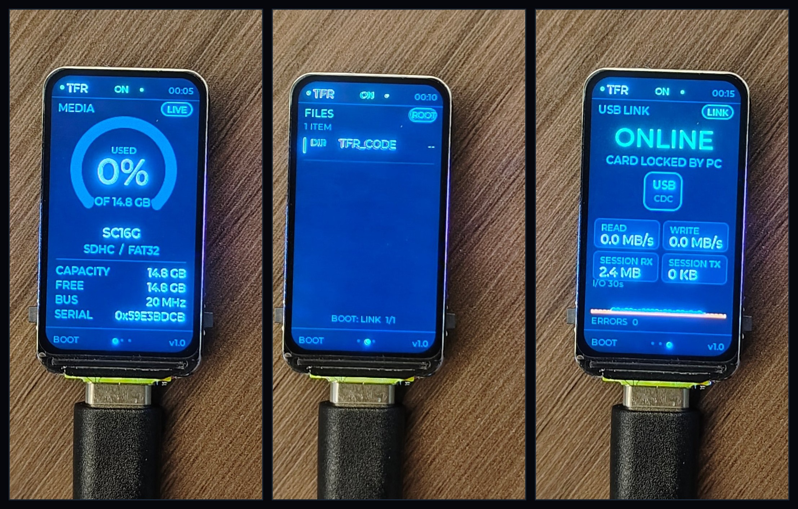
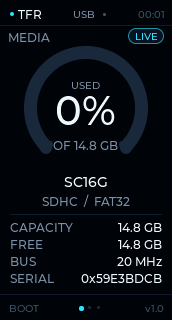
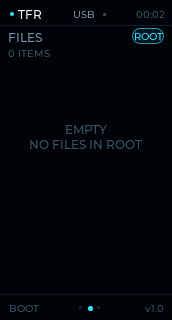
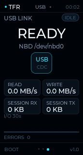
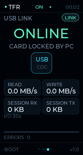

# TFR-1 · 可视化 TF 读卡器

Waveshare **ESP32-C6-LCD-1.47** 的个人 DIY 项目：1.47" 屏幕显示 TF 卡容量、卡身份、文件列表与实时 I/O；插上 USB 后，Linux 主机通过一个小型 NBD 桥接把整张卡挂载成 `/dev/nbd0`，可正常 `mount`、读写，屏幕同时显示 **ONLINE / CARD LOCKED BY PC** 和吞吐。

## 实拍



*实拍：CARD、FILES（卡内 `TFR_CODE` 源码复制测试）、USB LINK（PC 独占模式）。*
[CARD 原图](docs/photo-card.jpg) · [FILES 原图](docs/photo-files.jpg) · [HOST 原图](docs/photo-host.jpg)

## 界面截图






异常卡的两个状态（64 GB 无牌假卡实测）：[CARD / FAULT](docs/ui-card-fault.png) · [LINK / FAULT](docs/ui-link-fault.png)

## 先说清楚：它不是“真 USB 读卡器”

ESP32-C6 只有 **USB Serial/JTAG（12 Mbps）**，没有 USB OTG，因此**无法枚举成 USB Mass Storage 盘符**。本项目用 USB CDC 跑一条自定义块协议，再由 Linux 主机上的 `tfreader_host.py` 通过内核 **NBD** 暴露成块设备。这是当前硬件下最接近“真读卡器”的做法。

代价：

- PC 端需要 Linux + `nbd` 内核模块 + `sudo`，不是免驱即插即用；
- 实测顺序读约 **0.20–0.25 MB/s**，适合文档/照片/小文件，不适合 4K 视频；
- 16 GB FAT32 的 `mount`/`umount` 约 7 s / 37 s，因为内核要读约 10 MB FAT 元数据，**不要中途 Ctrl-C**；
- 挂载期间卡由 PC 独占，板端文件列表会显示 `CARD LOCKED`；断开桥接后自动重新挂载并恢复浏览。

## 功能

- 172×320 竖屏，深色仪表盘风格：容量环、卡型号/CID、FAT 信息、20 MHz 总线、实时读写速率与 30 秒 I/O 曲线；
- 卡状态区分：`无卡` / `NO FS`（卡在，但 FATFS 读不了 exFAT/NTFS/未格式化）/ `FAULT`（卡在，但块级自检发现所有地址读回同一块）。后两者仍显示真实容量与 CID，不再误报为"没插卡"；
- 根目录文件列表（目录优先，隐藏 `SYSTEM~1` 等系统项），文件大小与类型；
- USB 链路页：`READY / ONLINE`、`NBD /dev/nbd0`、会话读/写量、错误计数；卡异常时显示 `NO FS` / `FAULT`；
- RGB 灯：待机深蓝、有卡青色、主机模式薄荷绿、卡异常红色；
- BOOT 键：短按切页/翻文件页，长按重新扫描；
- 屏幕截图：主机端可把当前 UI 抓成 PNG（调试/文档用）。

## 快速开始

### 1. 依赖

- ESP-IDF **5.5.3**（本机 `~/esp/esp-idf-5.5.3`）
- Python 3 + `pyserial`
- Linux `nbd` 内核模块

```bash
./scripts/setup.sh
```

### 2. 构建 / 烧录

```bash
./scripts/flash.sh
# 或
source ~/esp/esp-idf-5.5.3/export.sh
idf.py -p /dev/ttyACM0 flash
```

### 3. 启动 USB-NBD 桥（终端 A）

```bash
./scripts/run.sh
# 等价于：sudo python3 host/tfreader_host.py --attach
```

看到 `[nbd] attached /dev/nbd0` 后，保持这个终端运行。

### 4. 挂载（终端 B）

```bash
./scripts/mount.sh          # 默认 /dev/nbd0 -> /mnt/tfreader
ls -la /mnt/tfreader
```

卸载：

```bash
./scripts/umount.sh
# 然后在终端 A 按 Ctrl-C，桥接会 detach 并让板子重新挂载 TF 卡
```

> 卡上若有分区表，设备是 `/dev/nbd0p1`；无分区表（superfloppy）则直接是 `/dev/nbd0`。`mount.sh` 会自动判断。

### 5. 只查看信息 / 测速 / 截屏

```bash
python3 host/tfreader_host.py --info --logs
python3 host/tfreader_host.py --bench 4          # 读 4 MiB
python3 host/tfreader_host.py --ui-page 2 --screenshot docs/ui-link.png
```

## 按键

| 操作 | 行为 |
|---|---|
| BOOT 短按 | CARD → FILES → LINK → CARD；FILES 页有多页时先翻页 |
| BOOT 长按 ≥0.9 s | 重新扫描 TF 卡根目录 |

无触摸屏；这是这块板唯一的板载按键。RESET 仍是硬件复位。

## 实测结果（本机 + 这张 SC16G 卡）

| 项目 | 结果 |
|---|---|
| 固件构建 | `idf.py build` 通过，`tfreader.bin` 699,344 B，3 MB app 分区剩余约 78% |
| NBD 挂载 | `/dev/nbd0p1` vfat 挂载成功 |
| NBD 顺序读 | `dd 4 MiB` → **249–253 kB/s** |
| NBD 写 | 128 KiB 写入 + 回读 SHA-256 一致 |
| 直连协议读 | 4 MiB → **0.20–0.21 MiB/s**（16 KiB 帧） |
| 持续读 | 8 MiB 直连读通过，无 panic |
| 屏幕 | 172×320 方向/偏移正确，截图见 `docs/` |
| 空闲堆 | 约 **151 KB**（截图缓冲释放后） |
| 挂载 / 卸载耗时 | 本卡约 **7 s / 37 s**（16 GB FAT32；内核会读约 10 MB FAT 元数据，属带宽瓶颈，不是卡死） |

### 卡兼容性 / 故障判定

| 卡 | 结果 |
|---|---|
| 16 GB SC16G（FAT32） | 挂载、文件列表、1 MiB 直读 0.20 MiB/s、NBD 全通过 |
| 64 GB 无牌卡 `SDABC` | **FAULT**：`sdmmc_card_init` 通过、CSD 报 58.24 GiB，但任意 LBA 都读回同一 512 B 块（前 4 字节固定、其后为最后一次写入内容），FATFS 无法挂载 → 判定为假容量/损坏卡 |
| exFAT / NTFS / 未格式化 | `NO FS`：卡被识别并显示容量，但 FATFS 只支持 FAT12/16/32，需要格式化或在 PC 端经 NBD 挂载 |

判定是**只读**的：读 LBA 0、容量中点、末尾前 16 扇区，三者内容完全相同且不是全 `0x00`/`0xFF` 才判 `FAULT`，不会写卡、不会误伤空白卡。诊断信息同时写进设备日志：`--logs` 可见 `mount failed ESP_FAIL; raw card 59638 MB (FAULT: all LBAs alias)`。

### 强制导出 / 格式化尝试（诊断用）

默认 `--attach` 拒绝导出 FAULT 卡，避免 PC 端写入被静默别名。确实要做诊断或格式化尝试时，需显式加 `--force`：

```bash
sudo python3 host/tfreader_host.py --attach --force   # 终端 A：导出 /dev/nbd0
sudo mkfs.vfat -F 32 -n TFRFIX /dev/nbd0              # 终端 B
sudo mount -t vfat /dev/nbd0 /mnt/tfreader
```

这**不是修复**。本项目的 64 GB `SDABC` 假卡实测：`mkfs.vfat` 返回 0、写入约 9.5 MB，
但挂载仍报 `invalid media value (0x5c)`；重新初始化后 LBA 0 仍读不到引导扇区。
问题在块地址而非文件系统，格式化“成功”不会让 FAULT 消失。

## 目录

```
main/                固件
  display/           ST7789T + LVGL 显示
  sd_card.c          TF 卡 FAT / 原始块双模式
  usb_link.c         USB CDC 帧协议
  ui.c               三页仪表盘 UI
  spi_guard.c        LCD/SD 共享 SPI 的总线互斥
host/tfreader_host.py  Linux NBD 桥 + CLI + 截屏
scripts/             构建、烧录、运行、挂载
docs/                设计说明与 UI 截图
```

## 已验证 / 未验证

**已验证（真实硬件）**

- 构建、烧录、启动；
- TF 卡挂载、CID/容量读取、文件列表；
- USB 帧协议、NBD attach、分区识别、vfat 挂载；
- 4 MiB 顺序读、128 KiB 写 + SHA-256 回读；
- 三页 UI 与主机模式 UI（截图）；
- Ctrl-C detach 后板端重新挂载；
- 卡状态区分（`NO FS` 显示真实容量、`FAULT` 只读自检）——用一张 64 GB 无牌假卡实测；
- 换卡对照：同一固件、同一卡座，16 GB SC16G 正常挂载，64 GB `SDABC` 判 `FAULT`。

**未验证 / 已知限制**

- exFAT / NTFS / ext4 卡仍不能挂载（会显示 `NO FS`）；本项目只实现了 FAT12/16/32；
- 热插拔（运行中拔卡）的主机错误恢复；
- Windows / macOS 主机（NBD 方案主要面向 Linux）；
- 长时间（>8 MiB）连续读写的稳定性与发热；
- 真 USB MSC 盘符——C6 硬件不支持，换 ESP32-S3/P4 才可以。

## 设计取舍（简版）

完整记录见 [docs/DESIGN.md](docs/DESIGN.md)。

- **Key Judgment**：不伪造 MSC；用 USB CDC + 主机 NBD，保留“整卡块设备”语义，PC 可挂载、格式化、fsck。
- **Avoided Misfix**：没有用 FUSE 文件夹方案（不能格式化/分区），也没有把 FATFS 缓存和 PC 裸写混在一起（会破坏文件系统）。
- **Root Cause**：LCD 与 TF 共用 SPI2；LVGL 异步刷新和 SDSPI 轮询会撞 SPI 硬件命令，实测触发 `spi_hal_setup_trans` assert。用应用层 `spi_guard` 串行化整个 LCD flush 与 SD 事务，core dump 复现并确认修复。
- **Host mode**：PC attach 时卸载 FATFS、独占原始块；8 秒无心跳自动释放；detach 后重新挂载 FATFS。

## 许可

代码为个人 DIY 项目，未附许可证；引用的 LVGL（MIT）与 Waveshare 示例（Apache-2.0）保留其原有版权。
